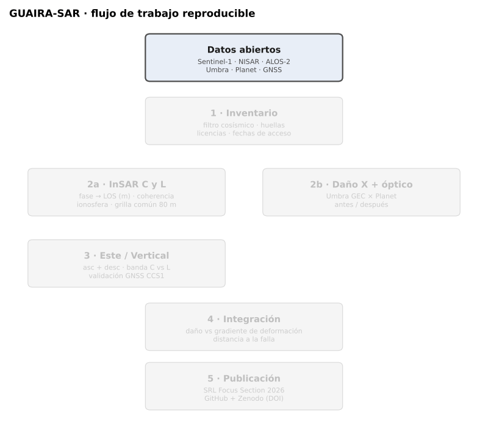
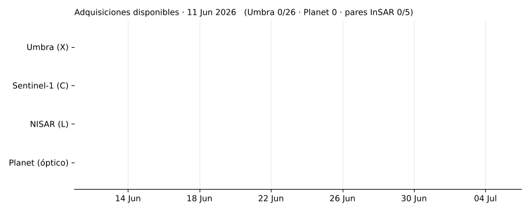
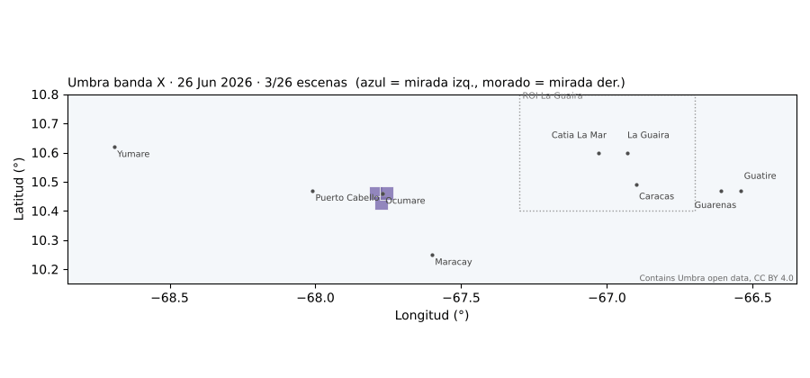

# GUAIRA-SAR · SAR_multifrequency

**🇬🇧 From fault to façade: multi-frequency SAR (C-, L- and X-band) and high-resolution optical observations of the 24 June 2026 Venezuela earthquake doublet along the La Guaira coast**

**🇪🇸 De la falla a la fachada: observaciones SAR multifrecuencia (bandas C, L y X) y ópticas de alta resolución del doblete sísmico del 24 de junio de 2026 en Venezuela, a lo largo de la costa de La Guaira**

[](https://colab.research.google.com/github/jf-floresriera/SAR_multifrequency/blob/main/notebooks/01_Inventario_Multisensor.ipynb)
[](https://colab.research.google.com/github/jf-floresriera/SAR_multifrequency/blob/main/notebooks/02_Procesamiento_InSAR_multifrecuencia.ipynb)


| 🇬🇧 English | 🇪🇸 Español |
|---|---|
| Reproducible, open-data workflow for a manuscript in preparation for the *Seismological Research Letters* Focus Section on the **2026 Venezuela, Colombia and Panama Earthquakes**. | Flujo de trabajo reproducible y con datos abiertos para un artículo en preparación para la sección especial de *Seismological Research Letters* sobre los **sismos de 2026 en Venezuela, Colombia y Panamá**. |

---

## 1 · The event / El evento

| 🇬🇧 | 🇪🇸 |
|---|---|
| On 24 June 2026 a strike-slip earthquake doublet (Mw 7.2 at 22:04:33 UTC, followed 30–40 s later by Mw 7.5) ruptured the San Sebastián – Boconó fault system along the northern coast of Venezuela. La Guaira state, between Catia La Mar and Caraballeda, concentrated the most severe damage. | El 24 de junio de 2026 un doblete sísmico de rumbo (Mw 7,2 a las 22:04:33 UTC y, 30–40 s después, Mw 7,5) rompió el sistema de fallas San Sebastián – Boconó en la costa norte de Venezuela. El estado La Guaira, entre Catia La Mar y Caraballeda, concentró los daños más graves. |

## 2 · Scientific question / Pregunta científica

| 🇬🇧 | 🇪🇸 |
|---|---|
| **How do SAR frequency and resolution shape what we observe of the same earthquake?** We compare coseismic deformation in **C-band (Sentinel-1)** and **L-band (NISAR, ALOS-2)**, both with ascending and descending geometry to retrieve **East and Up**, and building-scale damage from **sub-metre X-band SAR (Umbra, day and night)** versus **0.5–3 m optical imagery (Planet)**. | **¿Cómo cambia lo que observamos de un mismo sismo según la frecuencia y la resolución del radar?** Comparamos la deformación cosísmica en **banda C (Sentinel-1)** y **banda L (NISAR, ALOS-2)**, ambas con órbita ascendente y descendente para obtener **Este y Vertical**, y el daño a escala de edificio con **radar banda X submétrico (Umbra, de día y de noche)** frente a **imágenes ópticas de 0,5–3 m (Planet)**. |

## 3 · Workflow / Flujo de trabajo

<p align="center"></p>

| Step / Paso | 🇬🇧 What is done | 🇪🇸 Qué se hace | Code / Código |
|---|---|---|---|
| **1** | Discover every open dataset; classify NISAR GUNW as pre-, co- or post-seismic; Umbra STAC metadata; Umbra × Planet overlaps; Sentinel-1 coseismic pairs; licences and access dates | Buscar todos los datos abiertos; clasificar los GUNW de NISAR en pre, co y postsísmicos; metadatos STAC de Umbra; cruces Umbra × Planet; pares cosísmicos de Sentinel-1; licencias y fechas de acceso | `notebooks/01_…` |
| **2a** | Phase → LOS (m) with **one sign convention for all sensors**; coherence ≥ 0.3; NISAR ionosphere; common UTM 19N 80 m grid | Fase → LOS (m) con **un solo signo para todos los sensores**; coherencia ≥ 0,3; ionosfera NISAR; grilla común UTM 19N de 80 m | `notebooks/02_…` |
| **2b** | Umbra GEC amplitude (dB) vs. Planet post-event and the Q1-2026 pre-event mosaic on the same 0.5 m grid | Amplitud Umbra GEC (dB) frente a Planet después del sismo y el mosaico previo del primer trimestre de 2026, en la misma grilla de 0,5 m | `src/cruce_umbra_planet.py` |
| **3** | Asc + desc least-squares **East/Up**, separately for **C** and **L**; L − C difference maps; GNSS check at CCS1 | **Este/Vertical** por mínimos cuadrados con asc + desc, por separado en **C** y **L**; mapas de diferencia L − C; validación GNSS en CCS1 | `notebooks/02_…` |
| **4** | Damage vs. deformation gradient and distance to the fault; airport, port and viaduct profiles | Daño frente a gradiente de deformación y distancia a la falla; perfiles en aeropuerto, puerto y viaducto | *in progress / en curso* |
| **5** | GitHub release → Zenodo DOI; derived products on Zenodo; *Data and Resources* section | Versión en GitHub → DOI de Zenodo; productos derivados en Zenodo; sección *Data and Resources* | — |

## 4 · Data / Datos

<p align="center"></p>

| Band / Banda (λ) | Sensor | 🇬🇧 What we use · 🇪🇸 Qué usamos | Dates / Fechas (2026) | Licence / Licencia |
|---|---|---|---|---|
| **C** (5.55 cm) | Sentinel-1A/1D | HyP3 INSAR_GAMMA · tracks **033A** + **025D** · 40 m · look vectors / vectores de mirada | 18 → 25 Jun | Copernicus (free / libre) |
| **L** (23.8 cm) | NISAR | GUNW · **061A**, **162A** (asc) + **126D** (desc) + 054D | 13 Jun → 4 Jul (12 d) | NASA (free / libre) |
| **L** (23.8 cm) | ALOS-2 PALSAR-2 | ScanSAR L1.1 · *pending / pendiente* | JAXA obs. from / desde 30 Jun | JAXA free release (3 Jul 2026) |
| **X** (3.1 cm) | Umbra | 26 spotlight (GEC, SICD, SIDD) · post-event only, several at night / solo post-evento, varias nocturnas | 26 Jun → 2 Jul | CC BY 4.0 |
| Optical / Óptico | Planet SkySat · PlanetScope | 17 post-event / después + Q1-2026 mosaic / mosaico previo | 26–28 Jun · Jan–Mar | CC BY-NC 4.0 (not redistributed / no se redistribuye) |
| Optical / Óptico | Sentinel-2 L2A | True colour / color verdadero | Jun–Jul | Copernicus |
| GNSS | CCS1 (+ others / otras) | Coseismic offsets for validation / desplazamientos para validar | — | Cited / citado |

<p align="center"></p>

| 🇬🇧 | 🇪🇸 |
|---|---|
| **Umbra coverage:** La Guaira coast (left + right look), eastern Caracas, Guarenas–Guatire (11 collects), Ocumare / Henri Pittier (left + right look) and Yumare (near the Mw 7.2 epicentre). There is no repeat-pass geometry, so X-band is used for amplitude-based damage mapping, not InSAR. | **Cobertura Umbra:** costa de La Guaira (mirada izquierda + derecha), Caracas este, Guarenas–Guatire (11 escenas), Ocumare / Henri Pittier (izquierda + derecha) y Yumare (cerca del epicentro del Mw 7,2). No hay geometría repetida, así que la banda X se usa para mapear daño con la amplitud, no para InSAR. |

## 5 · Preliminary results / Resultados preliminares

> 🇬🇧 First-pass figures from the exploratory notebook (Sentinel-1 track 033A at 80 m, NISAR GUNW). They will be replaced by the harmonised C/L products of step 3.
> 🇪🇸 Figuras de la primera aproximación (Sentinel-1 track 033A a 80 m, NISAR GUNW). Se reemplazarán por los productos armonizados C/L del paso 3.

| | |
|---|---|
|  |  |
| **🇬🇧** NISAR GUNW footprints (co-, pre-, post-seismic) and Umbra collects. **🇪🇸** Huellas GUNW de NISAR (co, pre y postsísmicas) y escenas Umbra. | **🇬🇧** Umbra collects coloured by days after the earthquake. **🇪🇸** Escenas Umbra coloreadas por días desde el sismo. |
|  |  |
| **🇬🇧** Sentinel-1 033A: coherence, wrapped interferogram and LOS displacement. **🇪🇸** Sentinel-1 033A: coherencia, interferograma envuelto y desplazamiento LOS. | **🇬🇧** LOS displacement zooms: airport/port and Macuto–Naiguatá. **🇪🇸** Acercamientos del LOS: aeropuerto/puerto y Macuto–Naiguatá. |
|  |  |
| **🇬🇧** LOS vs. elevation check for stratified tropospheric delay. **🇪🇸** Control LOS vs. elevación para el retraso troposférico estratificado. | **🇬🇧** Exploratory profile across Viaduct No. 1 (80 m pixels: only a few pixels span the structure; to be revisited at 40 m and with Umbra). **🇪🇸** Perfil exploratorio del Viaducto N° 1 (píxel de 80 m: pocos píxeles cubren la estructura; se revisará a 40 m y con Umbra). |

## 6 · How to run / Cómo ejecutar

| 🇬🇧 Google Colab (recommended) | 🇪🇸 Google Colab (recomendado) |
|---|---|
| 1. Click an **Open in Colab** badge above.<br>2. Run the cells **in order** (cell 1 installs, cell 2 mounts Drive).<br>3. A NASA Earthdata account is needed for downloads and HyP3.<br>4. If Colab restarts, start again from cell 1. Outputs stay in Drive. | 1. Haga clic en un botón **Open in Colab** de arriba.<br>2. Ejecute las celdas **en orden** (la 1 instala, la 2 monta Drive).<br>3. Se necesita cuenta NASA Earthdata para descargar y usar HyP3.<br>4. Si Colab se reinicia, empiece por la celda 1. Los resultados quedan en Drive. |

```bash
# Local
git clone https://github.com/jf-floresriera/SAR_multifrequency.git
cd SAR_multifrequency
conda env create -f environment.yml
conda activate guaira-sar
jupyter lab notebooks/

# Regenerate README animations / Regenerar las animaciones del README
python docs/make_animations.py
```

## 7 · Repository layout / Estructura del repositorio

```
SAR_multifrequency/
├── notebooks/
│   ├── 01_Inventario_Multisensor.ipynb               # inventory · HyP3 · downloads / inventario · HyP3 · descargas
│   └── 02_Procesamiento_InSAR_multifrecuencia.ipynb  # common InSAR · E/U · GNSS / InSAR común · E/V · GNSS
├── src/                       # same code as scripts / mismo código como scripts
├── docs/
│   ├── img/                   # README figures and animations / figuras y animaciones
│   ├── make_animations.py     # reproducible GIF generator / generador reproducible de GIF
│   └── notas_procesamiento.md # processing log / bitácora de procesamiento
├── figures/                   # final SRL figures / figuras finales para SRL
├── environment.yml · CITATION.cff · LICENSE
```

| 🇬🇧 | 🇪🇸 |
|---|---|
| Heavy data (`.h5`, `.tif`, `.zip`, `.nitf`) are **never** committed; they live in Google Drive during processing, and derived products will be archived on Zenodo. | Los datos pesados (`.h5`, `.tif`, `.zip`, `.nitf`) **nunca** se suben al repositorio; viven en Google Drive durante el procesamiento y los productos derivados se archivarán en Zenodo. |

## 8 · Conventions / Convenciones

| Item / Elemento | 🇬🇧 | 🇪🇸 |
|---|---|---|
| LOS sign / Signo LOS | **+ = toward the satellite**, all sensors | **+ = hacia el satélite**, todos los sensores |
| Units / Unidades | metres | metros |
| Grid / Grilla | UTM 19N (EPSG:32619), 80 m | UTM 19N (EPSG:32619), 80 m |
| Coherence / Coherencia | γ ≥ 0.3 | γ ≥ 0,3 |
| Time / Hora | UTC (local = UTC − 4 h) | UTC (local = UTC − 4 h) |
| Look side / Lado de mirada | NISAR looks **left**, Sentinel-1 **right** | NISAR mira a la **izquierda**, Sentinel-1 a la **derecha** |

## 9 · Status / Estado

| | 🇬🇧 | 🇪🇸 |
|---|---|---|
| ✅ | Multi-sensor inventory | Inventario multisensor |
| ✅ | NISAR coseismic GUNW downloaded (061A, 162A, 126D) | GUNW cosísmicos NISAR descargados (061A, 162A, 126D) |
| ✅ | Sentinel-1 coseismic pairs submitted to HyP3 | Pares cosísmicos Sentinel-1 enviados a HyP3 |
| ⏳ | Sentinel-1 40 m with look vectors | Sentinel-1 a 40 m con vectores de mirada |
| ⏳ | ALOS-2 ScanSAR interferometry | Interferometría ALOS-2 ScanSAR |
| ⏳ | East/Up C vs L and GNSS validation | Este/Vertical C vs L y validación GNSS |
| ⏳ | Umbra × Planet damage figures | Figuras de daño Umbra × Planet |
| ⏳ | Manuscript, Zenodo, submission (deadline 21 Dec 2026) | Manuscrito, Zenodo, envío (fecha límite 21 dic 2026) |

## 10 · Attribution / Atribución

- Contains modified Copernicus Sentinel data (2026), processed by ESA and ASF HyP3. / Contiene datos Copernicus Sentinel modificados (2026), procesados por ESA y ASF HyP3.
- NISAR data courtesy of NASA/JPL-Caltech and ISRO, distributed by ASF DAAC. / Datos NISAR cortesía de NASA/JPL-Caltech e ISRO, distribuidos por ASF DAAC.
- ALOS-2 PALSAR-2 data © JAXA. / Datos ALOS-2 PALSAR-2 © JAXA.
- Contains Umbra open data, licensed under CC BY 4.0. / Contiene datos abiertos de Umbra, licencia CC BY 4.0.
- Imagery © Planet Labs PBC, Planet Crisis Response Program, CC BY-NC 4.0. / Imágenes © Planet Labs PBC, programa Crisis Response, CC BY-NC 4.0.

## 11 · Citation and licence / Cita y licencia

| 🇬🇧 | 🇪🇸 |
|---|---|
| Code: MIT ([`LICENSE`](LICENSE)). Cite with [`CITATION.cff`](CITATION.cff); a Zenodo DOI will be added on the first release. Data keep each provider's licence. | Código: MIT ([`LICENSE`](LICENSE)). Citar con [`CITATION.cff`](CITATION.cff); se añadirá un DOI de Zenodo en la primera versión. Los datos conservan la licencia de cada proveedor. |
