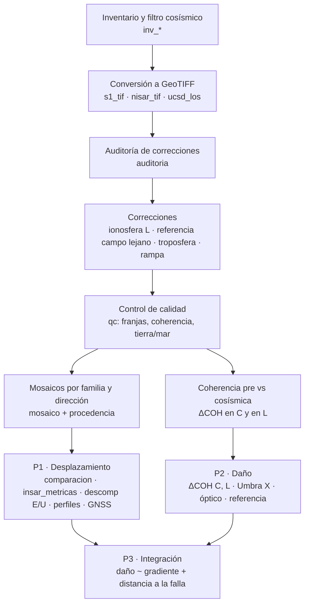

# Metodología del artículo: comparación multibanda de desplazamiento y daño / Paper methodology: multi-band comparison of displacement and damage

> 🇪🇸 Esquema metodológico del artículo, conectado paso a paso con el flujo reproducible (`notebooks/00_Maestro.ipynb`, `src/`). Estado al 27-nov-2026: ✅ hecho y probado con datos reales · 🟡 hecho, falta revisar con datos reales o completar · ⬜ por hacer. Reemplaza la sección «Método» de `PROYECTO.md` donde haya contradicción.
> 🇬🇧 Methodological outline of the paper, linked step by step to the reproducible workflow. Status as of 27 Nov 2026. Supersedes the «Method» section of `PROYECTO.md` where they disagree. English version at the end.

## 1. Preguntas de investigación
| | Pregunta | Datos que la responden |
|---|---|---|
| **P1 · Desplazamiento** | ¿Cuánto difieren la banda C (Sentinel-1, λ = 5,5 cm) y la banda L (NISAR, ALOS-2, λ ≈ 24 cm) al medir el desplazamiento cosísmico (LOS, Este, Vertical) y por qué (coherencia, vegetación, relieve, gradiente cerca de la falla, ventana temporal)? | Interferogramas C y L ascendentes y descendentes, GNSS CCS1 |
| **P2 · Daño** | ¿Qué banda y qué observable detecta mejor el daño urbano: amplitud en banda X (Umbra, submétrica), **pérdida de coherencia** en C y en L, o el óptico de alta resolución (Planet, Vantor)? | Umbra X, pares de coherencia pre y cosísmicos (C, L), óptico antes/después, daño de referencia (HOTOSM, Copernicus EMS) |
| **P3 · Integración** | ¿Se relaciona el daño con la deformación (gradiente, distancia a la falla San Sebastián)? | Mapas de P1 + daño de P2 |

**Hipótesis de trabajo:** la banda L conserva coherencia en vegetación y relieve y resuelve el campo lejano de la deformación; la banda C se decorrela más pero muestra más detalle donde es coherente; el daño a escala de edificio solo es visible con banda X y óptico submétrico, mientras que C y L lo ven como pérdida de coherencia a escala de manzana.

## 2. Datos por banda
| Banda | Sensor | Geometría y fechas (2026) | Rol | Estado |
|---|---|---|---|---|
| C | Sentinel-1 (HyP3 INSAR_GAMMA, 40 m) | 033A asc 18→25 jun · 025D desc 18→25 jun | desplazamiento, coherencia | ✅ |
| L | NISAR (GUNW, 80 m) | 162A asc 13→25 jun (frames 006+007) · 061A asc 18→30 jun · 054D desc 17→29 jun · 126D desc 22 jun→4 jul (frames 083+084) | desplazamiento, coherencia, ionosfera | ✅ |
| L | ALOS-2 (procesado por UCSD, sin corrección ionosférica, no revisado por pares) | 040A asc 14 ene 2025→30 jun · 134D desc 10 jun→8 jul · 135D desc 15→29 jun | comparación externa en banda L | ✅ (externo) |
| X | Umbra (spotlight, sin geometría repetida) | 26 adquisiciones 26 jun→2 jul | daño por amplitud y textura | 🟡 |
| Óptico | Planet SkySat (post), Vantor/Maxar (antes y después, ~0,4 m) | antes: ene–abr 2026 · después: 25–29 jun | daño visual, validación | 🟡 |
| GNSS | CCS1 | dE ≈ −0,464 m, dN ≈ −0,011 m, dU ≈ +0,021 m (publicado) | validación y signo | ⬜ faltan coordenadas exactas |
| Referencia de daño | HOTOSM (automático), Copernicus EMS EMSR884 | — | verdad de campo aproximada | ✅ descargado |

## 3. Flujo de trabajo

## 4. Métodos por bloque
### 4.1 Preprocesamiento común (✅)
- LOS en **mm**, convención **+ = acercamiento al satélite**; NISAR mira a la izquierda y Sentinel-1 a la derecha (el signo se fija con GNSS).
- Máscara de coherencia (umbral elegido con el barrido 0,1–0,4 del `qc`); el mar se excluye y se reporta la cobertura **sobre tierra**.
- Malla común lon/lat de 0,0008° (≈ 88 m) para comparar; el desenvolvimiento lo hizo el proveedor sobre la **escena completa** (los recortes son posteriores).
- NISAR: un archivo por frame; ionosfera restada con la pantalla de división espectral del GUNW.

### 4.2 Correcciones (ver `CORRECCIONES_INSAR.md`)
| Corrección | C (S-1) | L (NISAR) | L (ALOS-2, UCSD) | Estado |
|---|---|---|---|---|
| Referencia a campo lejano (> 20 km de fallas) | sí | sí | sí | ✅ |
| Ionosfera | despreciable | pantalla GUNW | **no** (declarado) | ✅ / ⚠️ |
| Troposfera estratificada (fase–elevación) o ERA5/GACOS | pendiente | según banderas del GUNW | — | ⬜ |
| Marea terrestre | ≲ 1 cm | capa en el GUNW | — | ⬜ |
| Rampa orbital | pendiente | pendiente | — | ⬜ |
| Saltos de desenvolvimiento (componentes conexas) | — | `_concomp.tif` sin usar aún | — | ⬜ (prioridad: costura NISAR ASC con RMS 147–171 mm vs MAD 3–33 mm) |

### 4.3 P1 · Comparación del desplazamiento C vs L
1. **Mapas LOS** por familia y dirección con la misma ventana y escala (`comparacion`, ✅ código; 🟡 falta revisar la corrida real).
2. **Este/Vertical** por banda con ascendente + descendente (N ≈ 0, justificado por GNSS dN ≈ −1 cm) y **L − C** (`descomp`, 🟡 repetir tras corregir frames).
3. **Perfiles** perpendiculares a la falla con mediana ± MAD por banda (`insar_metricas`, 🟡 falta ± MAD).
4. **Estadísticas**: sesgo, RMSE, R², pendiente y Bland–Altman entre bandas y frente a UCSD; prueba de Kolmogorov–Smirnov de L − C; cobertura y ruido en campo lejano por banda; coherencia por cobertura del suelo (ESA WorldCover); incertidumbre por semivariograma (⬜ salvo sesgo/RMSE/R²/pendiente frente a UCSD ✅).
5. **Validación GNSS** en CCS1 (⬜, faltan coordenadas).
6. Advertencia: las ventanas incluyen distinta cantidad de días tras el sismo (S-1: 1 día; NISAR 162A: 1; 061A: 6; 054D: 5; 126D: 10; ALOS-2 134D: 14) → parte de las diferencias puede ser posísmica (Fig. 7).

### 4.4 P2 · Detección de daño por banda
1. **Coherencia (C y L)**: daño ≈ pérdida de coherencia entre un par **pre-sísmico** y uno **cosísmico** de la misma geometría: ΔCOH = coh_pre − coh_co, con umbral estadístico en zonas sin daño (método tipo «mapa proxy de daño», como el de ARIA/JPL; citar). ⬜ **Falta un par pre-sísmico por sensor:** Sentinel-1 033A 13→18 jun (1 trabajo HyP3 nuevo, no duplica nada) y NISAR 126D 10→22 jun (GUNW listado en el inventario NISAR; no está en Drive). Es la pieza que permite comparar C y L **también en daño**.
2. **Banda X (Umbra)**: amplitud (Lee 5×5), textura (CV 9×9), NDLI; métricas por clase de daño (Kruskal–Wallis, delta de Cliff, bootstrap) (🟡 v2 existe, rehacer con estilo y coordenadas).
3. **Óptico**: Planet SkySat (después) y Vantor (antes y después, ~0,4 m, CC BY-NC) para interpretación y para validar (🟡 `vantor` listo).
4. **Referencia**: HOTOSM (automático, con ruido de etiqueta) y Copernicus EMS (✅ descargado).
5. **Métricas de detección** por banda: precisión, exhaustividad, F1, MCC (clases desbalanceadas), ROC/AUC con validación cruzada por bloques espaciales (⬜) → Tabla 3.

### 4.5 P3 · Integración
Regresión logística daño ~ distancia a la falla + gradiente de deformación (por banda), ROC/AUC y Moran de residuos; perfiles en infraestructura (aeropuerto, puerto, viaducto) (⬜).

## 4.6 Cobertura parcial de las escenas: decisión metodológica
Ninguna escena cubre toda la zona (p. ej. NISAR 061A solo el este; 162A el oeste; la mitad de cada huella es mar). No se descarta ninguna ni se «elige la mejor» a ojo: se aplica una regla explícita y se reporta la cobertura.
1. **Zona de estudio fija** (ventana de la costa de La Guaira) y **solo tierra**: el mar se excluye siempre (es incoherente) y la cobertura se informa sobre tierra (Tabla S1).
2. **Comparaciones solo en píxeles comunes**: C vs L se compara en Este/Vertical (no en LOS, porque cada sensor mira en otra dirección) y únicamente donde **ambas** bandas tienen dato sobre tierra; se informa el % común (Tabla S3).
3. **Este/Vertical solo con geometría ascendente + descendente** en el mismo píxel. Dos ascendentes (NISAR 162A + 061A) no separan Este de Vertical: producían ±1–2 m sin sentido; corregido el 27-nov.
4. **Mosaicos** (misma familia y dirección, desfase igualado en el solape, procedencia por pieza) **solo para mostrar** el patrón completo; las métricas se calculan en los productos individuales.
5. Literatura: la unión por solape y la corrección de desfases entre tracks son práctica común (ver HANDOFF §0.38 y las fuentes citadas allí); no encontramos un protocolo publicado específico para comparar sensores con cobertura parcial, por eso la regla se declara explícitamente en el artículo.

## 5. Figuras y tablas (texto principal ≤ 10; suplemento sin límite)
| Fig./Tabla | Contenido | Paso | Estado |
|---|---|---|---|
| Fig. 1 | Ubicación (contexto, regional, costa) | `mapas_base` | ✅ |
| Fig. 2 | LOS de todos los modelos (familia × ASC/DESC) | `mosaico` + `comparacion` | 🟡 |
| Fig. 3 | Este/Vertical C, L y L − C | `descomp` | 🟡 |
| Fig. 4 | Perfiles a través de la falla (todas las bandas) + GNSS | `insar_metricas` | 🟡 |
| Fig. 5 | Coherencia por banda y por cobertura del suelo (tierra/mar, WorldCover) | `qc` + nuevo | ⬜ |
| Fig. 6 | Daño por coherencia ΔCOH en C y en L | nuevo `danio_coherencia` | ⬜ |
| Fig. 7 | Diferencias por ventana temporal (posísmico temprano) | nuevo | ⬜ |
| Fig. 8 | Daño a escala de edificio: Umbra X + óptico (antes/después) | `danio_sitios` + `vantor` | 🟡 |
| Fig. 9 | Daño vs gradiente y distancia a la falla | nuevo | ⬜ |
| Fig. 10 | Infraestructura | nuevo | ⬜ |
| Tabla 1 | Datos por banda y producto (fechas, dirección, línea base, días tras el sismo, fuente) | `tablas` | 🟡 código listo (27-nov) |
| Tabla 2 | Procesamiento y correcciones por producto | `tablas` (de `auditoria` + `insar_metricas`) | 🟡 código listo |
| Tablas S1–S3 | Calidad (tierra vs mar), mosaicos, comparaciones C vs L y propio vs UCSD | `tablas` | 🟡 código listo |
| Tabla 3 | Detección de daño por banda (P/R/F1/MCC/AUC) | nuevo | ⬜ |
| Suplemento | QC por producto y por mosaico, paneles individuales, costuras y procedencia, propio vs UCSD | `qc`, `insar_metricas`, `mosaico` | ✅ código |

## 6. Datos que faltan para completar la comparación
1. **Par pre-sísmico de Sentinel-1** (033A, 13→18 jun): 1 trabajo HyP3 → habilita ΔCOH en C. *Requiere tu confirmación.*
2. **Par pre-sísmico de NISAR** (126D, 10→22 jun; y de 162A si existe): descargar el GUNW → ΔCOH en L.
3. **Coordenadas exactas de CCS1** → validación y signo.
4. (Opcional) Sentinel-1 T106A (oeste, Mw 7,2) solo si se amplía a toda la ruptura.

## 7. Limitaciones a declarar
UCSD no es revisión por pares; ALOS-2 sin corrección ionosférica; productos NISAR provisionales; ventanas temporales distintas; daño de referencia automático (ruido de etiqueta); Planet y Vantor CC BY-NC (compatibilidad con el acceso abierto de SRL por confirmar).

---

# 🇬🇧 English version

**Research questions.** P1 Displacement: how much do C-band (Sentinel-1) and L-band (NISAR, ALOS-2) differ in coseismic LOS/East/Up and why (coherence, vegetation, relief, near-fault gradient, time window)? P2 Damage: which band/observable best detects urban damage — X-band amplitude (Umbra), **coherence loss** in C and L, or high-resolution optical (Planet, Vantor)? P3 Integration: does damage relate to deformation (gradient, distance to the San Sebastián fault)?
**Workflow** (diagram above): inventory → GeoTIFF conversion → corrections audit → corrections (L-band ionosphere, far-field reference, troposphere, ramp) → QC (fringes, coherence, land/sea) → same-family/same-direction mosaics with provenance → P1 (comparison figure, metrics, East/Up, profiles, GNSS) and P2 (ΔCOH in C and L, Umbra X, optical, reference damage) → P3 (logistic regression, ROC/AUC, Moran).
**Status:** preprocessing, ionosphere, referencing, QC, mosaics and comparison code done; troposphere, ramp, unwrapping-jump masking, semivariogram, GNSS validation, ΔCOH damage maps and detection metrics pending.
**Missing data:** pre-seismic Sentinel-1 pair (033A 13→18 Jun, one new HyP3 job — needs the author's confirmation), pre-seismic NISAR pair (126D 10→22 Jun), exact CCS1 coordinates; optional S-1 T106A.
**Limitations:** UCSD not peer-reviewed; ALOS-2 without ionospheric correction; provisional NISAR products; different time windows; automatic reference damage; CC BY-NC optical imagery.
